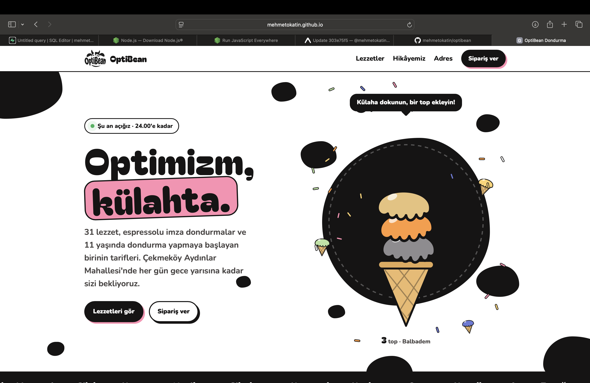

# 🍦 OptiBean Dondurma — Web Sitesi

Çekmeköy/İstanbul'daki **OptiBean** dondurma mağazasının resmi web sitesi. Mağaza bana ait; site gerçek müşterilere hizmet veriyor.

🔗 **Canlı site:** https://optibean.com.tr/



## Proje hakkında

OptiBean, klasik dondurmaların yanında kahve bazlı dondurmalar ve "Dadu" gibi kendi ürünlerini satan bir mağaza. İsmi, *optimizm* ile *salep çekirdeğinin* uyumundan geliyor. Bu siteyle amaç, mağazanın menüsünü, kimliğini ve sipariş bilgilerini tek, mobil uyumlu ve eğlenceli bir sayfada toplamaktı.

## Özellikler

- **Lezzet menüsü ve kategori filtresi** — 30'u aşkın lezzet JavaScript ile listeleniyor; kategori butonları her kategorideki ürün sayısını gösteriyor.
- **Seçim hafızası** — Seçilen kategori `localStorage` ile tarayıcıda hatırlanıyor (sayfa yenilense de kalıyor).
- **Kahve bazlı dondurmalar bölümü** — Mağazanın özel ürünleri için ayrı tasarım.
- **Animasyonlar** — 20'den fazla CSS `@keyframes` animasyonu (kartların girişi, sallanma, dönme vb.).
- **Sipariş ve iletişim** — Tek dokunuşla arama, Instagram ve Trendyol Yemek bağlantıları, adres ve çalışma saatleri.
- **Mobil uyumlu** — Telefon ekranına göre düzenlenen yerleşim.
- **Erişilebilirlik** — `aria-pressed`, `aria-live` gibi ARIA özellikleri.
- **Hızlı yükleme** — Ürün görselleri `.webp` formatında.

## Kullanılan teknolojiler

| Alan | Teknoloji |
|---|---|
| Yapı | HTML5 |
| Tasarım ve animasyon | CSS3 (değişkenler, flexbox/grid, keyframes) |
| Etkileşim | Vanilla JavaScript (kütüphane yok) |
| Yazı tipleri | Google Fonts (Bagel Fat One, Nunito) |
| Yayın | GitHub Pages |
| Geliştirme ortamı | VS Code, Git, GitHub |

## Dosya yapısı

```
optibean-site/
├── index.html   # Sayfanın tamamı: HTML, CSS ve JavaScript
└── img/         # Logo ve ürün görselleri (.webp)
```

## Bilgisayarda çalıştırma

```bash
git clone https://github.com/mehmetokatin/optibean-site.git
cd optibean-site
```

Ardından `index.html` dosyasını tarayıcıda açmanız yeterli; kurulum gerekmiyor.

## Geliştirme süreci

Site, yapay zekâ destekli bir geliştirme süreciyle hazırlandı: ihtiyaçları, içerikleri ve tasarım yönünü ben belirledim; kodlamada Claude'dan (AI asistanı) destek aldım. Siteyi GitHub Pages'te yayına aldım, güncellemelerini VS Code üzerinden kendim yapıyorum.

## Mağaza bilgileri

📍 Aydınlar Mahallesi, Kazım Karabekir Caddesi No 15/B, Çekmeköy/İstanbul
🕚 Her gün 11.00 – 24.00
📸 Instagram: [@optibean.ice](https://www.instagram.com/optibean.ice/)

---

Hazırlayan: **Mehmet Okatın** — Yeditepe Üniversitesi, Yönetim Bilişim Sistemleri
